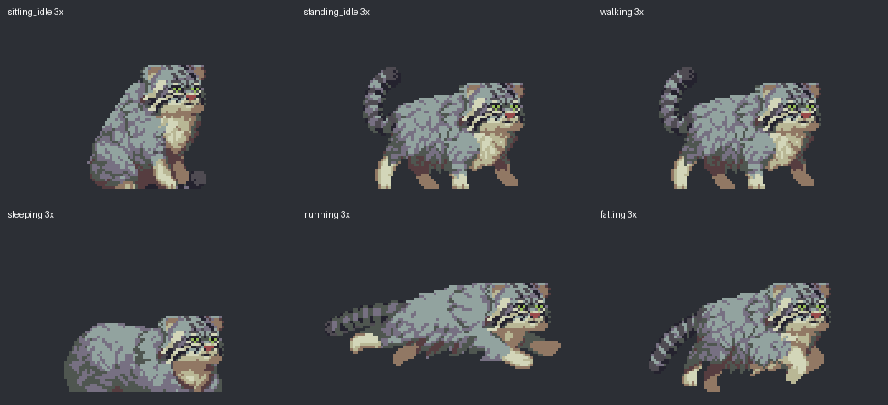

# Подключённый набор animations_new

Источник: `E:/Assets/DesktopPet/animations_new`.
Установленные ресурсы: `assets/pixel/`, настройки: `assets/animations.json`.
Все 34 узла графа используют новый набор; обращений к старым PNG больше нет.
Оригиналы нового набора не изменены. Старые папки перенесены в
`E:/Assets/DesktopPet/legacy_before_pixel_pack` и не попадают в сборку.

## Размер и подготовка

Масштаб **3×**, nearest-neighbor без сглаживания. Видимый питомец:
сидя 141×147, стоя 192×144, в беге до 282 пикселей в ширину.
Прежний сидящий питомец был примерно 154×122 при масштабе 0.3.
Общий прозрачный холст 112×80 → окно 336×240; его размер не равен
размеру самого рисунка. Размер окна и нижняя опорная линия не меняются
при переключении клипов. При желании уменьшить питомца используйте
`defaults.scale: 2` в манифесте (целый масштаб сохраняет пиксели).

Импорт убирает лишние прозрачные поля, добавляет общий холст и сохраняет
смещения кадров внутри каждого клипа. У Scared исходные кадры разной ширины:
они дополнены прозрачностью. Пиксели, цвета и альфа не перерисованы.
Длительности подобраны в диапазоне 80–160 мс, статические позы — 100–200 мс.
Это настройки воспроизведения проекта, а не авторские тайминги: в PNG их нет.



## Готовые соответствия

| Узел проекта | Новый источник |
| --- | --- |
| sit_idle | Мнет хвост — кадры 16–25, цикл 120 мс/кадр |
| walk | Идет Версия 2 |
| stand_up | Встает |
| sit_down | Садится |
| run | 5. Running |
| alert | 1. Alerted |
| start_dig | 2. Digging: 000–004 |
| dig | 2. Digging: 005–010, цикл |
| end_dig | 2. Digging: 011–015 |
| start_clean | 3. Cleaning: 000–005 |
| clean | 3. Cleaning: 006–012, цикл |
| end_clean | 3. Cleaning: 013 → 000 |
| start_sandbath | 4. Sandbathing: 000–002, укладывание |
| sandbath | 4. Sandbathing: 003–008, цикл катания 780 мс |
| end_sandbath | 4. Sandbathing: 009–014, подъём |
| sleep | 2. Sleep — только 004–007 (дыхание) |
| meow | 4. Meowing |
| poop | 0. Toilet |
| startle | 0. Scared |
| start_sneak | 1. Sneaking: 000–002 |
| sneak | 1. Sneaking: 003–010, цикл подкрадывания |
| end_sneak | 1. Sneaking: 011–016 |

## Все отсутствующие самостоятельные анимации

В исходном наборе нет **8 отдельных клипов** для перечисленных ниже узлов.
Загрузочных пробелов нет: для каждого установлен кадр или фрагмент нового
набора. Важно различать полноценное переиспользование и временную подстановку.

| Узел | Что установлено сейчас | Нужен ли новый рисунок |
| --- | --- | --- |
| stand_idle | «3. Alerted2»: 002 → 003 → 004 → 003, по 240 мс | Лёгкое движение ушей при неподвижных корпусе и лапах; новый рисунок не нужен |
| drag | «Прыжок»: 3.png → 4.png → 5.png → 4.png | Экспортированные кадры 002 → 003 → 004 → 003; цикл 880 мс, кадры 003 сдвинуты вправо на 2 исходных пикселя |
| fall | «Прыжок»: 5.png → 6.png → 7.png | После отпускания: однократное продолжение прыжка, по 70 мс/кадр; последняя поза удерживается до касания земли |
| recover | «Прыжок»: 8.png–11.png | Полное приземление, 4 кадра по 90 мс; общая с jump и fall нормализация |
| swat | «Точит когти» | Временная замена. Для точного удара по курсору лучше отдельный короткий взмах; можно доработать существующие поднятые лапы |
| lie_down | 000–003 из «2. Sleep»: опускание головы | Промежуточного движения тела из сидячей позы нет |
| sit_up | 008–009 из «2. Sleep»: подъём головы | Промежуточного движения тела в сидячую позу нет |
| yawn | Замедленное «4. Meowing» | Временная замена. Для настоящего зевка доработать рот/голову имеющихся кадров; встроенные сценарии этот узел не вызывают |
| eat | «4. Meowing», 120 мс/кадр | Движение рта используется как жевание; затем запускается полное мытьё |

Приоритет художественной доработки: **swat → lie_down**. Кормление закрыто переиспользованием meow.
Обратное воспроизведение нового lie_down закроет sit_up. Hiding уже закрыт новым набором; yawn можно отложить.

## Дополнительное переиспользование

- «Мнет хвост» уже подключён как основная зацикленная sit_idle.
- «4. Sandbathing» подключена как start_sandbath → sandbath → end_sandbath:
  по 130 мс/кадр, 4–7 секунд основного цикла раз в 4–7 минут. Выход ждёт
  конца оборота. Все части используют общий crop, затем манул возвращается в idle.
- «3. Alerted2» — осматривание стоя или основа выглядывания с маской края.
- «Прыжок» — будущий прыжок целиком; сейчас используются только воздушный кадр
  и приземление. Для полного клипа понадобится согласование движения по экрану
  с перемещением тела внутри исходных кадров.
- «1. Sneaking» уже заменяет sneak: отдельную охоту рисовать не нужно.

Эти дополнительные сценарии, маски и обратное воспроизведение не добавлены:
они перечислены как способы сократить дальнейшую работу художника.

## Воспроизводимость и проверка

```powershell
python scripts/import_animation_pack.py E:/Assets/DesktopPet/animations_new
python scripts/validate_assets.py --strict
python -m unittest discover -s tests -q
```

Импорт и его тесты требуют Pillow (есть в requirements-build.txt).
Точные исходные имена кадров и тип подстановки записаны в `assets/pixel/sources.json`.
Импорт не переносит старые папки автоматически и не меняет исходник.
`assets/` по правилам проекта исключён из Git; сохраняйте художественный набор
отдельно. Скрипт импорта воспроизводит манифест и подготовленные кадры.

Результат после обновления 15 октября: 59 тестов проходят; все 27 клипов проходят строгую проверку.
Настоящий виджет проверен offscreen во всех позах: окно 336×240 и стабильная
нижняя опорная линия. Сценарии hide и scratch_screen дополнительно проверены с настоящим Qt-таймером
в offscreen-режиме; EXE пересобран. Проверка на реальном рабочем столе с курсором
не выполнялась.


## Обновление 15 октября: hide и scratch_screen

Добавлены исходные спрайт-листы из `animations_new/hide` и
`animations_new/scratch_screen`. Они разбиты на PNG при импорте:

| Набор | Вход 000.png | Цикл 001.png | Выход 002.png |
| --- | --- | --- | --- |
| hide | 9 кадров по 64×71 | 7 кадров по 64×71 | 5 кадров по 64×71 |
| scratch_screen | 10 кадров по 115×89 | 6 кадров по 115×89 | 9 кадров по 115×89 |

У hide/002.png последняя ячейка экспортирована частично (ширина листа 288).
Она дополнена прозрачностью до 64 пикселей; видимые пиксели не обрезаны.
Вход/цикл/выход каждого набора используют единые координаты: движение внутри
кадров сохранено, отдельные фазы не центрируются независимо. Hiding выровнен
по краю окна и зеркалируется для правого края экрана.

Hiding: постепенно убежать целиком за край → скрыться на 3–6 секунд → выпрыгнуть → лежать
и смотреть 5–10 секунд → упрыгнуть → скрыться на 1–2 секунды → выбежать
на землю из-за края экрана с постепенным появлением. Та же механика используется
в сценарии enter при запуске. Ожидание начинается после полного проигрывания входа, выход
проигрывается до конца перед скрытием. Перетаскивание отменяет сценарий
и его таймеры. Планировщик ожидает завершения hide, прежде чем запустить другое действие.

Царапанье: переход в стойку → вход → зацикленное царапанье → выход →
возврат в спокойную позу. Время просьбы о еде отсчитывается после входа.
Граф включает выход и при переходе к другому действию.

Высота исходного рисунка в царапанье достигает 74 пикселей, поэтому общий
холст увеличен до 80 пикселей. Масштаб персонажа остался 3×. Превью в начале
документа показывает предыдущий размер прозрачного холста; размер самого
персонажа не изменился.

Проверка реального воспроизведения: `python tests/smoke_animations.py`.

Sitting_idle: 10 кадров «Мнет хвост» (16–25), 120 мс/кадр (1,2 с на цикл).
Кадр 15 исключён как нейтральная поза, кадр 26 — как точный дубль 16.
Исходные файлы сохранены; отбор закреплён в скрипте импорта.
Масштаб 3× и общий холст 112×80 сохранены.


## Sleep: разделение фаз

По согласованию используются только доступные исходные рисунки:

- `lie_down`: 000–003, по 140 мс — опускание головы перед сном.
- `sleep`: 004–007, по 180 мс — только дыхание, цикл 720 мс.
- `sit_up`: 008–009, по 160 мс — пробуждение/подъём головы, затем sit_idle.

Ранее все 10 кадров проигрывались в sleep, поэтому в каждом обороте
повторялись засыпание и пробуждение. Теперь они вынесены в одноразовые клипы.
Для трёх фаз используется общий crop и координаты, чтобы не смещать рисунок.
При штатном пробуждении таймер запрашивает выход, но sit_up начинается
только после окончания текущего оборота дыхания (задержка до 720 мс).
`on_animation_loop_finished(node)` доступен сценариям для таких переходов.

В исходниках нет движения всего тела из сидячей позы в лежачую и обратно.
Поэтому на этих двух внешних стыках остаётся смена позы; опускание/подъём головы
и сам цикл сна используют реальные кадры. Новые рисунки не генерировались.


## Cleaning: три этапа

- `start_clean`: 000–005 — подъём лапы и подготовка, 600 мс.
- `clean`: 006–012 — умывание с поднятой лапой, цикл 700 мс.
- `end_clean`: 013 → 000 — опускание лапы и спокойная поза, 200 мс.

Время кадра — 100 мс. Весь набор использует общий crop и координаты,
поэтому при переходе между этапами рисунок не центрируется заново.
Умывание продолжается 2–5 секунд после входа, затем завершается текущий
оборот и запускается `end_clean`. Сценарий освобождается после опускания
лапы. Масштаб 3× сохранён. Штатный путь в графе:
`sit_idle → start_clean → clean → end_clean → sit_idle`.

После обновления: 68 тестов проходят. С настоящим Qt-таймером проверены
все три этапа и возврат в idle; ошибки отсутствующих входа/цикла/выхода
проверены отдельно.


## Digging: три этапа

- `start_dig`: 000–004, по 90 мс — подготовка к копанию, 450 мс.
- `dig`: 005–010, по 90 мс — основной цикл, 540 мс.
- `end_dig`: 011–015, по 90 мс — завершение и возврат в стойку, 450 мс.

Фазы используют единые координаты и общий crop всего исходного клипа.
Сценарий туалета копает 1,5–2,5 секунды, осмотр уведомлений — 2–4 секунды;
отсчёт начинается после входа в dig. Выход запрашивается по таймеру
и запускается на границе оборота. Оба сценария остаются активны до окончания
end_dig; только затем туалет запускает run, а уведомления завершаются.
Граф также проводит обычный переход к другому действию через end_dig.
Перетаскивание, как и раньше, немедленно прерывает анимацию.

Проверены реальное Qt-воспроизведение, отмена таймеров и ошибка отсутствующего
выходного клипа. После обновления проходят 71 тест; в наборе 31 клип.


## Sneak: непрерывный цикл подкрадывания

- `start_sneak`: 000–002, по 100 мс — переход из стойки в низкую позу.
- `sneak`: 003–010, по 100 мс — только подкрадывание, оборот 800 мс.
- `end_sneak`: 011–016, по 100 мс — завершение шага и возврат в стойку.

Внутреннее имя sneak сохранено для совместимости с логикой охоты на курсор.
Ранее в одном цикле были все 17 кадров, поэтому манул вставал на каждом обороте.
Начало, цикл и выход теперь используют общие координаты и crop всего набора.
Движение по экрану начинается после start_sneak; обновление цели и поворот
не перезапускают клип. При достижении дистанции прыжка перемещение останавливается
и сразу проигрывается end_sneak: оставшаяся часть цикла шагов пропускается,
чтобы манул не шагал на месте. При отмене охоты выход ждёт конца текущего оборота.
После выхода охота продолжается прыжком, а отменённое подкрадывание возвращается
в idle. Повторный сигнал конца цикла не перезапускает выход.
Перетаскивание отменяет всю цепочку немедленно.

Проверены два непрерывных оборота в настоящем Qt-проигрывателе, оба вида выхода,
отмена перетаскиванием и отсутствие выходного клипа. Проходят 76 тестов.


## Hunting: прыжок, захват и копание

Добавлен `jump`: все 11 исходных кадров из «Прыжок», по 70 мс.
Встроенное перемещение в исходных холстах компенсируется при импорте:
каждый рисунок центрирован и выровнен по нижней линии, цвета/альфа сохранены.
Это позволяет двигать окно по отдельной дуге к реальному положению курсора
без удвоения смещения и без увеличения холста/масштаба. Первые два кадра —
подготовка на земле, кадры 2–6 — полёт, 7–10 — приземление.

Последовательность: start_sneak → sneak → end_sneak → jump →
start_dig → dig → end_dig → idle. Перед прыжком манул останавливается
поодаль, при приземлении переносит курсор под передние лапы и удерживает
пружиной 1,5 секунды. Основное копание длится 2,5 секунды, выход ждёт границы
оборота. После завершения действует 60-секундная пауза всех реакций на курсор.
При промахе (мышь ушла дальше радиуса захвата) курсор не переносится, но
копание и пауза сохраняются.

Отмена освобождает курсор и останавливает таймеры. Перетаскивание сохраняет
текущую позицию в воздухе, остальные отмены полёта возвращают на землю.
Проверены обе стороны, края экрана, траектория и неподвижная подготовка,
захват/освобождение, пауза, ошибки клипов и отмена. Проходят 87 тестов;
реальное Qt-воспроизведение проверяется с подменённым курсором.
